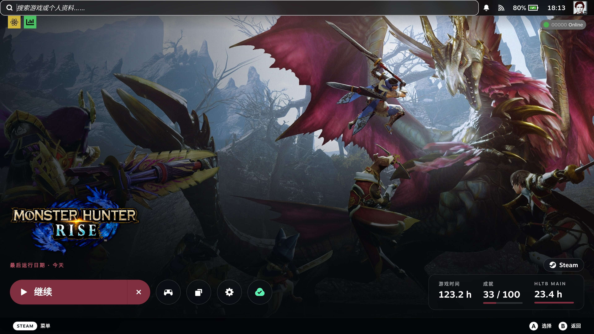
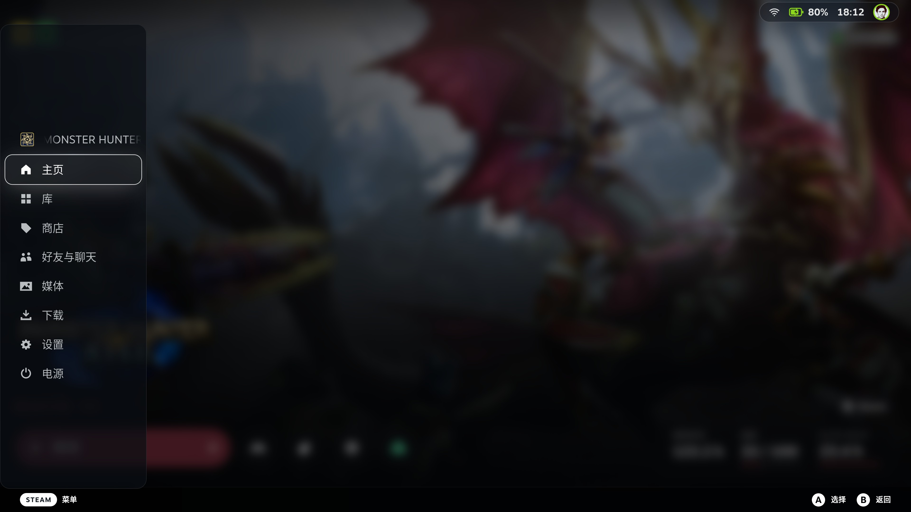
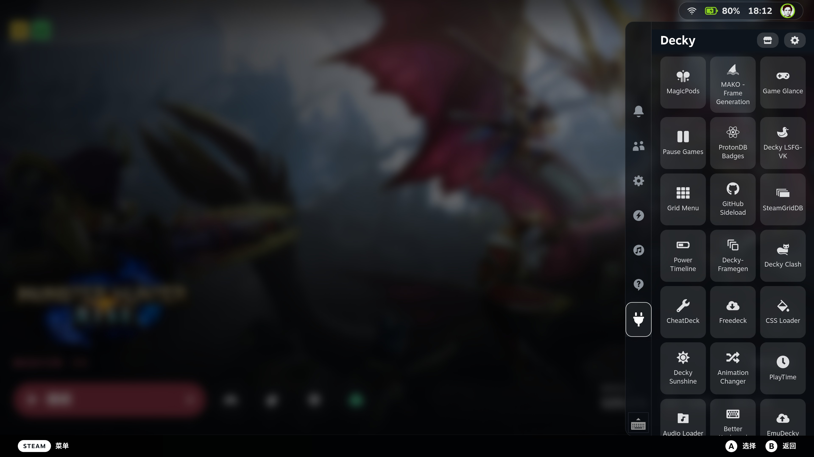
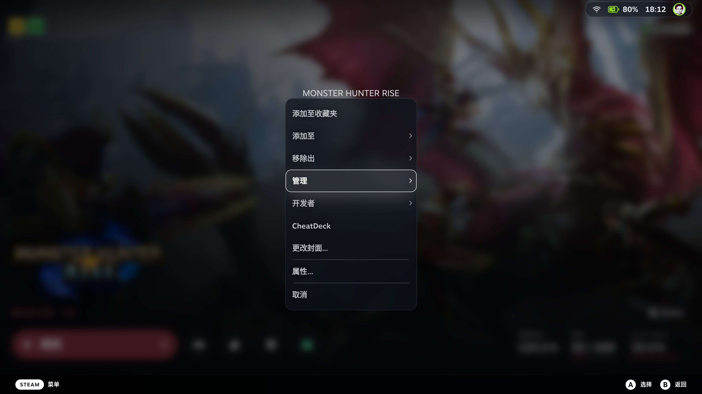

<h1 align="center">Decky Glance Theme</h1>

> A CSS Loader theme that applies one glass visual language across Steam Deck Game Mode.

<p align="center">
  <a href="./README.md">English</a> · <a href="./README.zh-CN.md">简体中文</a>
</p>
<p align="center">
  <a href="#install">Install</a> · <a href="#what-it-changes">Surfaces</a> ·
  <a href="#options">Options</a> · <a href="#limitations">Limitations</a>
</p>

<p align="center">
  
  <br>
  <sub>Header. The capsule is Glance; the hero art blur is Steam's own background.</sub>
</p>

## What it changes

| Surface | File | Window |
| --- | --- | --- |
| Steam button menu | `shared.css` | MainMenu |
| Game context menu and settings scrim | `context-menu.css` | SP |
| Quick Access Menu | `qam.css` | QuickAccess |
| Library covers and collection focus | `library.css` | SP |
| Home header, system buttons, search, Play | `home.css` | SP |
| Volume OSD | `volume.css` | SP |
| Dialogs, settings rows, recording cards, confirm prompts | `dialog.css` | SP |

<p align="center">
  
  <br>
  <sub>Steam button menu.</sub>
</p>
<p align="center">
  
  <br>
  <sub>Quick Access Menu.</sub>
</p>
<p align="center">
  
  <br>
  <sub>Game settings menu.</sub>
</p>


## Install

Install [Decky Loader](https://github.com/SteamDeckHomebrew/decky-loader) and [CSS Loader](https://github.com/suchmememanyskill/SDH-CssLoader). Copy this repository into the themes directory so the folder that contains `theme.json` is named `Glance`:
```sh
git clone https://github.com/ZacharyQin/decky-glance-theme.git \
  "$HOME/homebrew/themes/Glance"
```

On a Steam Deck the home directory is `/home/deck`. Restart CSS Loader, or toggle the theme off and on, then enable **Glance**.

<details>
<summary>Install from a local checkout</summary>

```sh
mkdir -p "$HOME/homebrew/themes"
ln -s "$PWD" "$HOME/homebrew/themes/Glance"
```

Keep this checkout in place. CSS Loader reads the files from that folder.

</details>

## Options

CSS Loader shows these controls on the theme. Each default is the current look. CSS Loader has no button control, so there is no one-click reset; move a slider back to the default stop.

| Option | Default | Applies to |
| --- | --- | --- |
| Panel opacity | 72% | QAM, Steam menu, context menu, dialogs |
| Panel blur | 14px | same, `Off` removes the blur |
| Panel corner radius | 16px | same |
| Glass color | `#0E141B` | same; opacity stays on the slider |
| Volume opacity | 40% | volume OSD only |
| Volume blur | 6px | volume OSD only |
| Header opacity | 38% | home header only |
| Settings scrim opacity | 50% | settings scrim only |
| Settings scrim blur | 8px | settings scrim only |

The volume OSD, header, and settings scrim do not share the panel sliders. They are all drawn in the Game Mode window, so one variable would move them together.

## Limitations

- CSS variables use the `--glance-` prefix.
- Patch names are the labels. CSS Loader has no per-language field for them.
- The theme uses `!important` where Steam's own rules would otherwise win.
- Settings rows, recording cards, and confirm dialogs each use their own markup. A radius change on one does not automatically cover the others.

## License

[MIT](./LICENSE). This is an independent theme, not an official Valve, Steam, Decky, or CSS Loader project.
