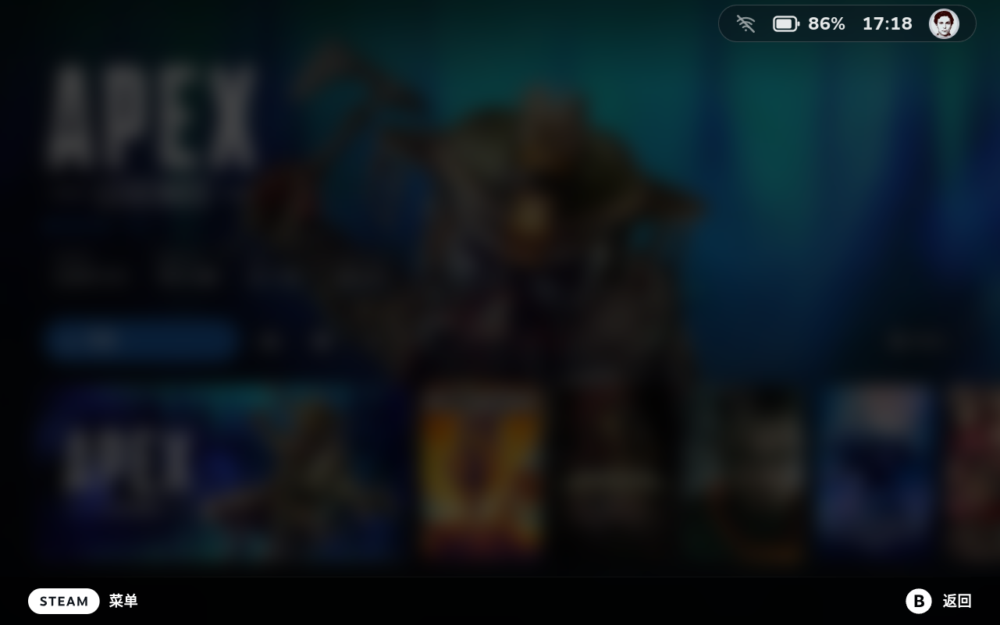
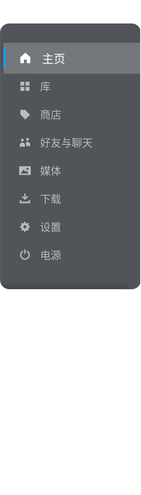

<h1 align="center">Decky Glance Theme</h1>

> 给 Steam Deck 游戏模式用的 CSS Loader 主题，把几处界面收成同一套玻璃。

<p align="center">
  <a href="./README.md">English</a> · <a href="./README.zh-CN.md">简体中文</a>
</p>
<p align="center">
  <a href="#安装">安装</a> · <a href="#改了哪些界面">界面</a> ·
  <a href="#配置">配置</a> · <a href="#限制">限制</a>
</p>

<p align="center">
  
  <br>
  <sub>游戏详情页。顶栏胶囊和底部是 Glance；英雄图发糊是 Steam 自己的背景。</sub>
</p>

## 改了哪些界面

| 界面 | 文件 | 窗口 |
| --- | --- | --- |
| Steam 键菜单 | `shared.css` | MainMenu |
| 游戏右键菜单和设置蒙层 | `context-menu.css` | 大屏 |
| 快速访问菜单 | `qam.css` | QuickAccess |
| 库封面和合集聚焦 | `library.css` | 大屏 |
| 主页顶栏、系统按钮、搜索、开始游戏 | `home.css` | 大屏 |
| 音量条 | `volume.css` | 大屏 |
| 弹窗、设置灰底行、游戏录制卡、确认框 | `dialog.css` | 大屏 |

<p align="center">
  
  <br>
  <sub>Steam 键菜单。</sub>
</p>


## 安装

先装 [Decky Loader](https://github.com/SteamDeckHomebrew/decky-loader) 和 [CSS Loader](https://github.com/suchmememanyskill/SDH-CssLoader)。把本仓库放到主题目录，包含 `theme.json` 的文件夹名要是 `Glance`：
```sh
git clone https://github.com/ZacharyQin/decky-glance-theme.git \
  "$HOME/homebrew/themes/Glance"
```

Steam Deck 上的家目录是 `/home/deck`。重启 CSS Loader，或把主题关掉再打开，然后启用 **Glance**。

<details>
<summary>从本地目录安装</summary>

```sh
mkdir -p "$HOME/homebrew/themes"
ln -s "$PWD" "$HOME/homebrew/themes/Glance"
```

目录要留在原地。CSS Loader 直接读这个文件夹。

</details>

## 配置

CSS Loader 的主题页里有这些项。默认档就是现在的样子。CSS Loader 没有按钮控件，所以没有一键重置；把滑条拨回默认档即可。

| 配置 | 默认 | 作用范围 |
| --- | --- | --- |
| 面板不透明度 | 72% | QAM、Steam 菜单、右键菜单、弹窗 |
| 面板模糊 | 14px | 同上，`Off` 会去掉模糊 |
| 面板圆角 | 16px | 同上 |
| 玻璃底色 | `#0E141B` | 同上；透明度仍走滑条 |
| 音量条不透明度 | 40% | 仅音量条 |
| 音量条模糊 | 6px | 仅音量条 |
| 顶栏不透明度 | 38% | 仅主页顶栏 |
| 设置蒙层不透明度 | 50% | 仅设置蒙层 |
| 设置蒙层模糊 | 8px | 仅设置蒙层 |

音量条、顶栏、设置蒙层不跟面板滑条走。它们都在大屏窗口里，共用一个变量会一动全动。

## 限制

- CSS 变量使用 `--glance-` 前缀。
- 配置名就是界面文案。CSS Loader 没有按语言切换的字段。
- 盖过 Steam 原样式的地方用了 `!important`。
- 设置行、录制卡和确认框是不同的结构。改一处圆角不会自动盖到另一处。

## 许可证

[MIT](./LICENSE)。这是独立主题，不是 Valve、Steam、Decky 或 CSS Loader 的官方项目。
